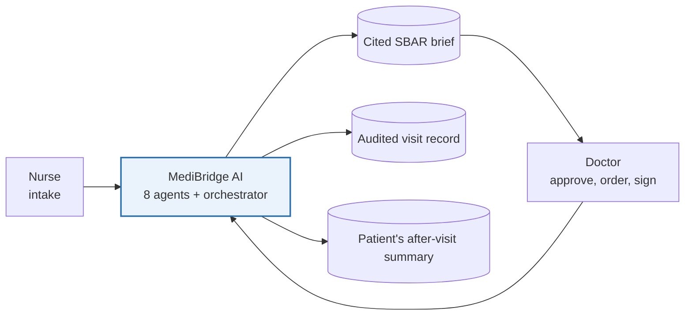
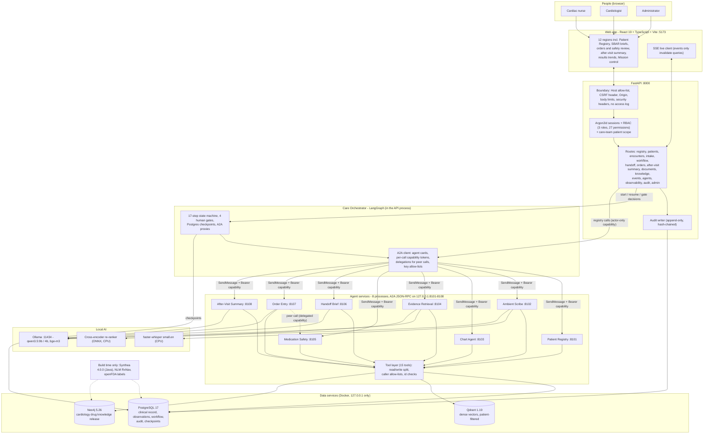
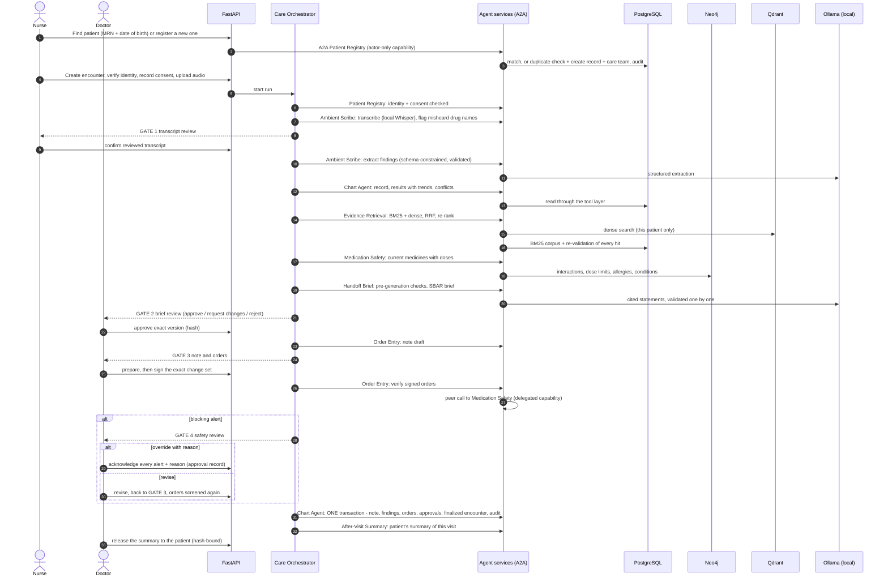
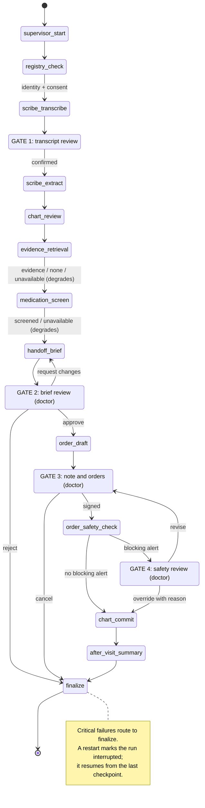
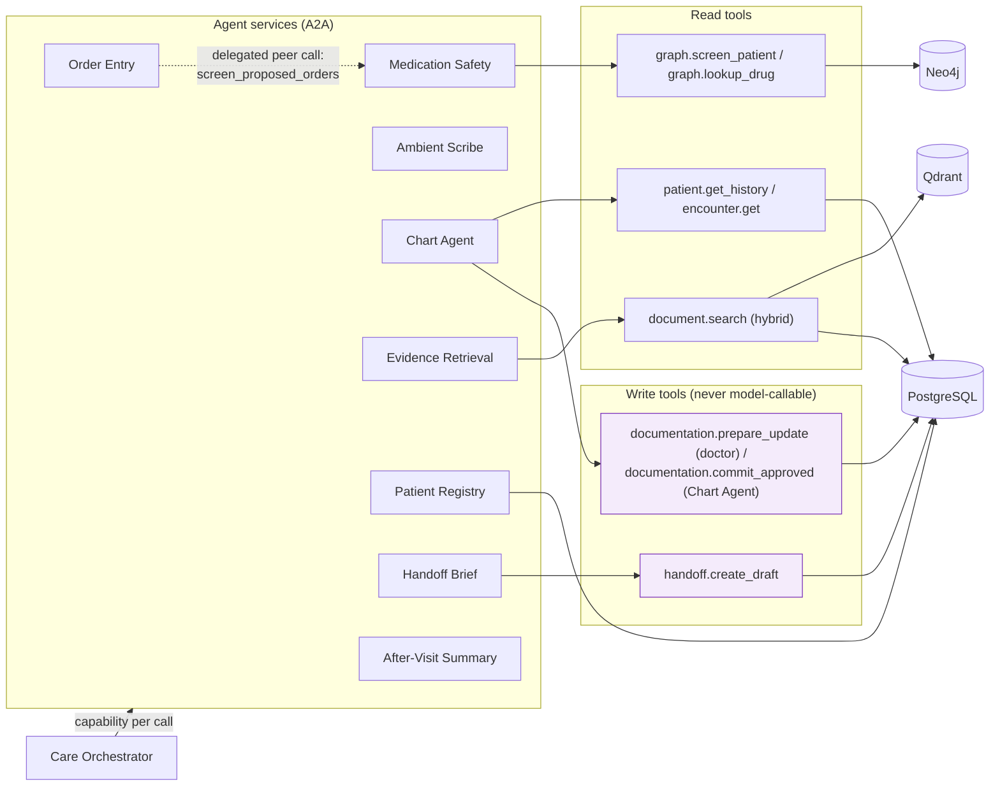
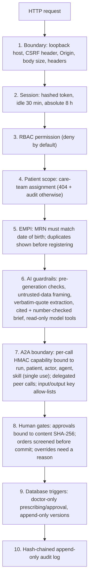
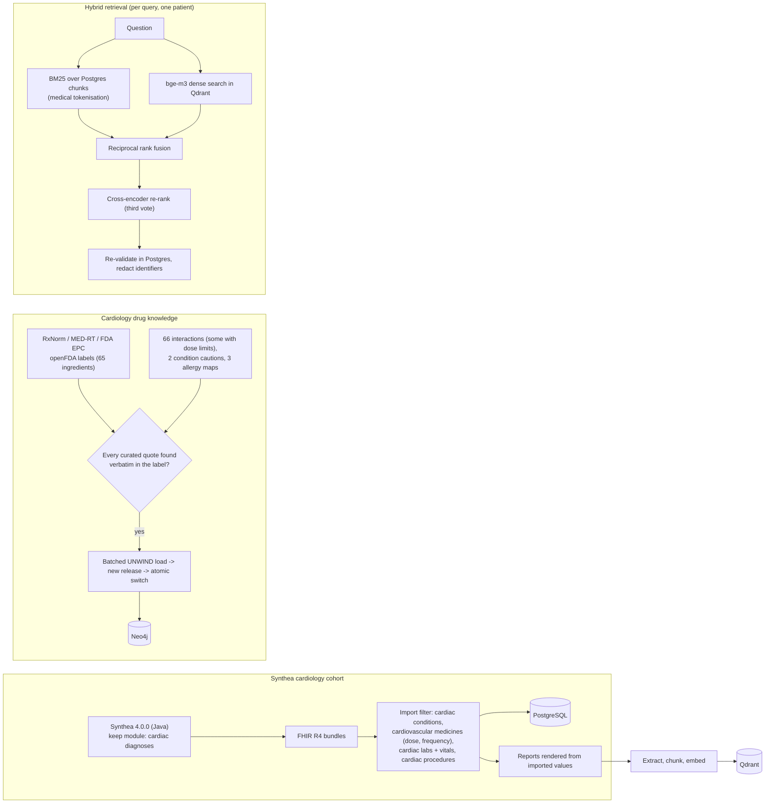
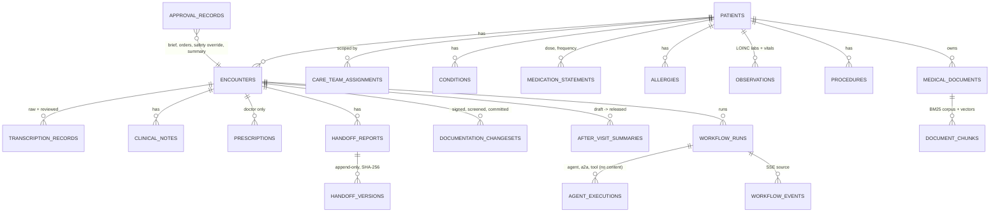
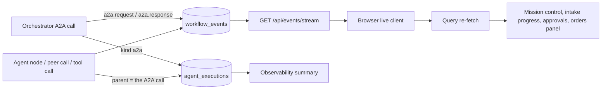
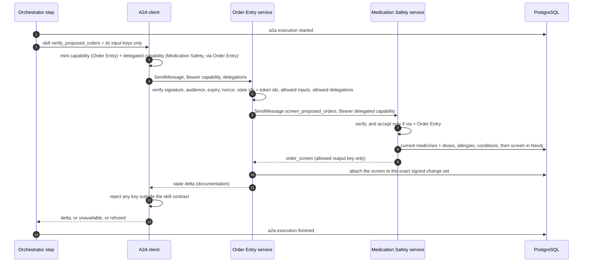

<div align="center">

# MediBridge AI - Local-First Cardiology Intake and Doctor Handoff

**MediBridge AI is a local-first system of cooperating AI agents. It takes a cardiology patient from the front desk to a signed, audited visit record in these steps:**

`find the patient` → `record and transcribe the intake` → `read the chart` → `find the evidence` → `screen the medicines` → `write the cited brief` → `doctor approves` → `screen the orders` → `commit the record` → `write the patient summary`.


**[Summary](#1-summary)** ·
**[Agents](#21-components)** ·
**[Workflow](#42-end-to-end-workflow)** ·
**[Run it](#8-how-to-run-medibridge-ai)** ·
**[Validation](#9-validation-results)** ·
**[Known problems](#10-known-problems)** ·
**[Glossary](#12-glossary)**

</div>

> [!NOTE]
> New machine? [SETUP.md](SETUP.md) has the end-to-end setup steps. It is written so that Claude Code can follow it.
> Open Claude Code in the project folder and say: *"Follow SETUP.md and set up this project end to end."*

> [!CAUTION]
> **MediBridge AI is a synthetic-data research and demo platform. It is not approved for clinical use.**
> The AI supports healthcare professionals. It does not replace clinical judgment.
> The escalation rules and the curated interaction set are demo content. No clinician has reviewed them.
> Do not put real patient data into this system.

---

MediBridge AI reads a patient's structured record, their prior reports and an intake conversation. It writes a cited cardiology handoff brief for the doctor.
A nurse does the intake. A doctor reviews, approves and signs. Nothing reaches the patient record without a doctor's approval.

**Everything runs on one machine.** Each port binds to `127.0.0.1`. No medical data goes to a hosted service.
Hosted language models are refused, unless two settings are on and an approval reference is recorded (see [8.5](#85-configuration)).

This README is the **one location that explains all of MediBridge AI**. It gives these topics:

- the general design and the design rules
- each of the 8 agents: its job, its port and its skills
- the workflow, the state machine, the security layers and the data model
- the data sources, and the runbook
- the validation results and the known problems

| If you are… | Read |
|---|---|
| A manager or reviewer | [1](#1-summary), [3](#3-design-rules), [9](#9-validation-results), [10](#10-known-problems), [11](#11-key-points) |
| A developer who joins the project | All sections, in sequence. Keep [8](#8-how-to-run-medibridge-ai) and [10](#10-known-problems) open while you work |
| An operator who runs the demo | [8](#8-how-to-run-medibridge-ai), then [docs/runbook.md](docs/runbook.md) |
| A clinician who reviews the workflow | [1](#1-summary), [4.2](#42-end-to-end-workflow), [4.3](#43-state-machine-langgraph), [6](#6-what-you-can-do), [10](#10-known-problems) |

---

## Table of contents

1. 🧭 [Summary](#1-summary)
   - 1.1 [The problem](#11-the-problem) · 1.2 [What MediBridge AI does](#12-what-medibridge-ai-does) · 1.3 [Why the system is local-first](#13-why-the-system-is-local-first) · 1.4 [Why a doctor approves each step that matters](#14-why-a-doctor-approves-each-step-that-matters)
2. 🏗️ [How MediBridge AI is built](#2-how-medibridge-ai-is-built)
   - 2.1 [Components](#21-components) · 2.2 [Technology stack](#22-technology-stack) · 2.3 [Repository layout](#23-repository-layout)
3. 🛡️ [Design rules](#3-design-rules)
4. 🔄 [Architecture and workflow](#4-architecture-and-workflow)
   - 4.1 [System architecture](#41-system-architecture) · 4.2 [End-to-end workflow](#42-end-to-end-workflow) · 4.3 [State machine (LangGraph)](#43-state-machine-langgraph) · 4.4 [Agents, peer calls and data access](#44-agents-peer-calls-and-data-access) · 4.5 [Security and guardrail layers](#45-security-and-guardrail-layers) · 4.6 [Data pipeline](#46-data-pipeline-cohort-knowledge-documents-and-hybrid-retrieval) · 4.7 [Data model](#47-data-model-main-tables) · 4.8 [Live monitoring](#48-live-monitoring) · 4.9 [One A2A call](#49-one-a2a-call-with-a-delegated-peer-call)
5. 🗃️ [Data](#5-data)
6. 🖥️ [What you can do](#6-what-you-can-do)
7. 🔒 [Security and deployment](#7-security-and-deployment)
8. ▶️ [How to run MediBridge AI](#8-how-to-run-medibridge-ai)
   - 8.1 [Prerequisites](#81-prerequisites) · 8.2 [Setup and start](#82-setup-and-start) · 8.3 [Sign in and try the demo](#83-sign-in-and-try-the-demo) · 8.4 [Run the tests](#84-run-the-tests) · 8.5 [Configuration](#85-configuration) · 8.6 [Fault diagnosis](#86-fault-diagnosis)
9. ✅ [Validation results](#9-validation-results)
10. ⚠️ [Known problems](#10-known-problems)
11. 📌 [Key points](#11-key-points)
12. 📖 [Glossary](#12-glossary)
13. 📜 [Reuse and licences](#13-reuse-and-licences)
14. 👤 [Author](#14-author)

---

## 1. Summary

### 1.1 The problem

A cardiologist has a short visit and a long record. Before the visit, someone must collect what the patient says, read the chart, find the relevant old reports and check the medicines.
This work is slow. It is also easy to get wrong: a missed anticoagulant and NSAID pair, or a denied symptom that is recorded as present.

The constraint for this project: **a doctor must be able to trust what the system shows, and must be able to check it.**
Thus, each statement in the brief cites its source. Each medicine alert quotes its drug label. Each approval is tied to the exact content that the doctor saw.

| Item | Value |
|---|---|
| Users | Cardiac nurse · Cardiologist · Administrator (3 roles, 27 permissions) |
| Agents | **8** specialist agent services (A2A, `127.0.0.1:8101`–`8108`) and 1 Care Orchestrator (LangGraph, in the API) |
| Workflow | **17** steps, **4** human gates, Postgres checkpoints |
| Language models | Local only: `qwen3.5:9b`, `qwen3.5:4b` and `bge-m3` through Ollama · faster-whisper `small.en` for speech |
| Data | Synthetic only: a [Synthea](https://github.com/synthetichealth/synthea) cardiac cohort of 60 patients, 474 reports, 65 drug ingredients, 66 curated interactions |
| Stores | PostgreSQL 17 · Qdrant 1.19 · Neo4j 5.26 (Docker, `127.0.0.1` only) |
| Interface | A React 19 web app with 12 regions, and a read-only MCP server |
| Status | Research and demo. Not approved for clinical use |



### 1.2 What MediBridge AI does

1. The nurse finds the patient in the **Patient Registry** (MRN and date of birth), or registers a first-time patient.
2. The intake conversation is recorded. The **Ambient Scribe** transcribes it locally. After a person reviews the transcript, it extracts symptoms, medicines, allergies and conditions.
3. The **Chart Agent** reads the structured record (PostgreSQL). **Evidence Retrieval** finds the relevant prior reports (BM25 and vector search, fused). **Medication Safety** screens current medicines and doses against a cardiology drug-knowledge graph (Neo4j, FDA and NLM sources).
4. The **Clinical Handoff Brief** writes a structured, cited cardiology brief (SBAR) after deterministic pre-generation checks. A doctor reviews and approves it.
5. The doctor writes the assessment, plan and orders. **Order Entry** asks **Medication Safety** to screen the proposed orders, agent to agent. A contraindication goes back to the doctor once: override with a reason, or revise.
6. The **Chart Agent** writes the record in one audited transaction. The **After-Visit Summary** agent writes the patient's own plain-language summary of the visit, which the doctor releases.

A **Care Orchestrator** (LangGraph) runs the workflow and the four human gates. The eight specialist agents are separate local services that it calls over the **A2A** protocol.

### 1.3 Why the system is local-first

A hosted model needs the patient's data to leave the machine. For a healthcare demo, this is the wrong default.
Thus, all models run locally through Ollama, faster-whisper and an ONNX runtime. Every port binds to loopback.
A hosted provider is refused unless `ALLOW_HOSTED_PHI=true` **and** `HOSTED_PHI_APPROVAL_REF` are both set. External tracing is off by default. If it is on, it sends only redacted metadata (ids, timings and statuses).

### 1.4 Why a doctor approves each step that matters

A language model can write a fluent statement that is false. The system does not rely on the model to be correct. It limits what the model can do:

- Extraction must quote the transcript verbatim, and a negation check runs on each finding.
- Each statement in the brief must cite a source. Numbers are checked against the record.
- The model has read-only tools. Write tools are never callable by a model.
- A doctor approves the exact version of a brief, a note and a set of orders. The approval is bound to the SHA-256 hash of the content.
- Medicine screening is deterministic. It does not use a model.

> A pipeline that **stops at a gate** fails *visibly*.
> A pipeline that **writes to the record by itself** can fail *invisibly*.

---

## 2. How MediBridge AI is built

### 2.1 Components

| Agent (A2A service) | Port | What it does | Skills |
|---|---|---|---|
| **Care Orchestrator** (supervisor, in the API) | - | Plans the run, enforces dependencies and the four gates, routes failures, finalizes | - |
| **Patient Registry (EMPI)** | 8101 | Master patient index: matches a returning patient by MRN + date of birth (or name + date of birth), registers a new patient with a duplicate check; confirms identity and consent before intake | `match_or_register_patient`, `verify_encounter_identity` |
| **Ambient Scribe** | 8102 | Local speech recognition (faster-whisper) with misheard-drug-name flags; extraction of findings from the reviewed transcript with verbatim grounding and negation checks | `transcribe_intake_audio`, `extract_clinical_entities` |
| **Chart Agent (EHR)** | 8103 | Reads the structured record (conditions, medicines with doses, allergies, lab results and vitals with trends, procedures, visits); writes the approved encounter back in one transaction with its audit entries | `assemble_patient_chart`, `commit_encounter_record` |
| **Evidence Retrieval** | 8104 | Hybrid search over the patient's reports: BM25 with medical tokenisation + dense vectors (Qdrant), reciprocal rank fusion, cross-encoder re-ranking; every hit re-validated in Postgres | `retrieve_clinical_evidence` |
| **Medication Safety CDS** | 8105 | Deterministic screen against the cardiology knowledge graph: interactions (label dose limits checked against the recorded dose), allergies, drug-condition cautions | `screen_current_medications`, `screen_proposed_orders` (peer-only) |
| **Clinical Handoff Brief** | 8106 | Structured SBAR cardiology brief; pre-generation checks; every statement cited and validated; privacy filter | `generate_handoff_brief` |
| **Order Entry (CPOE)** | 8107 | Drafts the note; verifies the doctor's signed orders and asks Medication Safety to screen them (agent-to-agent, delegated) | `draft_clinical_note`, `verify_proposed_orders` |
| **After-Visit Summary** | 8108 | The patient's summary of this visit: reason in their words, medicines and how to take them, next steps, when to get help | `generate_after_visit_summary` |

The orchestrator is not an agent service. It runs inside the API process and calls the eight services.
All agent code is in `agents/medibridge_agents/`. The A2A services are in its `a2a/` folder.

### 2.2 Technology stack

| Layer | Technology | Where | Why |
|---|---|---|---|
| Language | **Python 3.12 or 3.13**, managed with **uv** | Backend, agents, seed, knowledge | A locked dependency set (`uv.lock`) |
| API | **FastAPI**, Pydantic 2, SQLAlchemy 2, Alembic | `backend/` | Typed routes and versioned migrations |
| Orchestration | **LangGraph** with Postgres checkpoints | `agents/` | A resumable state machine with human gates |
| Agent protocol | **A2A** JSON-RPC (`a2a-sdk` 1.2.2) | `agents/.../a2a/` | Each agent is its own process, with an agent card |
| Local models | **Ollama** (`qwen3.5:9b`, `qwen3.5:4b`, `bge-m3`) · **faster-whisper** `small.en` · optional ONNX re-ranker (`fastembed`) | Agents, API | No patient data leaves the machine |
| Relational store | **PostgreSQL 17** | Docker | Clinical record, workflow, audit and checkpoints |
| Vector store | **Qdrant 1.19** | Docker | Dense search, filtered to one patient |
| Graph store | **Neo4j 5.26** | Docker | Cardiology drug-knowledge release |
| Web app | **React 19**, TypeScript, Vite, shadcn/ui components | `frontend/` | 12 regions with a live event stream |
| Security | **Argon2id** sessions, RBAC, HMAC capability tokens | API and A2A | See [7](#7-security-and-deployment) |
| Tests | pytest · Vitest · Playwright | `tests/`, `frontend/` | See [8.4](#84-run-the-tests) |
| Data generation | **Synthea 4.0.0** (Java 17+) at build time | `database/` | Synthetic cardiac cohort |

### 2.3 Repository layout

```
backend/medibridge_api      FastAPI app: models, routes (incl. registry), security, guardrails, providers,
                            services (hybrid retrieval: lexical.py BM25, rerank.py, vector_index.py)
agents/medibridge_agents    Care Orchestrator graph, agent nodes (registry, scribe, chart, retrieval, safety, brief,
                            orders, after-visit summary), tool layer, escalation rules;
                            a2a/: services, client, capabilities, peer calls, registry of agents and skills
mcp/medibridge_mcp          MCP server (read-only tools)
knowledge/                  Cardiology drug-knowledge fetcher, curated label-quoted set, batched Neo4j loader, screen
database/                   Alembic migrations; seed: Synthea generator + cardiac importer + scenarios
frontend/                   Dashboard (12 regions), Vitest + Playwright tests
infrastructure/             Docker Compose (Postgres, Qdrant, Neo4j; 127.0.0.1 only)
tests/                      Backend, security, workflow tests and AI evaluation harnesses
scripts/                    setup, start, stop, synthetic audio
docs/                       Architecture, guardrails, evaluation, runbook, implementation report
```

---

## 3. Design rules

### 3.1 Everything stays on the machine
All models are local. Each service binds to `127.0.0.1`. External tracing is off by default. A hosted model needs two settings and an approval reference.

### 3.2 A doctor decides, and the system records the decision
There are four human gates: transcript review, brief review, note and orders, and safety review. An approval is bound to the SHA-256 hash of the exact content. A change to the content needs a new approval.

### 3.3 The model never writes to the record
Write tools (`handoff.create_draft`, `documentation.prepare_update` and `documentation.commit_approved`) are not callable by a model. The Chart Agent writes the approved encounter in **one** audited transaction.

### 3.4 Each claim has a source
Extraction quotes the transcript. Each statement in the brief cites a record, a transcript segment or a document chunk. Each medicine alert quotes its FDA label. The curated-knowledge build refuses a quote that it cannot find in the label.
Each clinical fact carries its provenance (see [4.7](#47-data-model-main-tables)).

### 3.5 Safety checks are deterministic
Medication screening, the pre-generation checks, the escalation rules and the negation cross-check do not use a model. A model-free check gives the same answer each time.

### 3.6 Each agent can do only what its skill allows
Each A2A call carries a single-use capability token. It is bound to the run, the patient, the actor, the agent and the skill. Input and output keys have allow-lists. A peer call needs a delegated capability. Each refusal is audited.

### 3.7 Absence of an alert is not evidence of safety
The knowledge graph covers cardiology only. The interface says so. A drug outside the scope is listed as **not screened**.

### 3.8 Every action leaves a tamper-evident trace
The audit log is append-only and hash-chained. An administrator can verify the chain from the interface.

---

## 4. Architecture and workflow

Everything runs on one machine. Every port binds to `127.0.0.1`, and no medical data is sent to a hosted service.

### 4.1 System architecture



### 4.2 End-to-end workflow



### 4.3 State machine (LangGraph)



### 4.4 Agents, peer calls and data access



### 4.5 Security and guardrail layers



### 4.6 Data pipeline: cohort, knowledge, documents and hybrid retrieval



### 4.7 Data model (main tables)



Each clinical fact carries its provenance: `source_kind` (patient-reported, clinician-documented, record-retrieved, unconfirmed), `source_ref` (the Synthea resource, transcript segment, note or document chunk), `source_phrase`, `certainty` and `status`. Facts a demo scenario needed but the generated record lacked are marked `scenario-augmentation:<key>`.

### 4.8 Live monitoring



### 4.9 One A2A call, with a delegated peer call



Refusals (bad or reused tokens, another patient's state, over-sharing, a peer-only skill called directly, a rogue response) are audited and block the run. Set `AGENT_TRANSPORT=inprocess` to run the same agent code inside the API for debugging.

**Limitation.** The services share one `.env`, so they share the token secret and the database credentials. A token proves it was issued by a MediBridge process on this machine, not specifically by the orchestrator; access is still bounded per call by the token's binding and by the tool layer's permission checks inside each agent.

---

## 5. Data

All data is synthetic and open source.

- **Patients:** a [Synthea](https://github.com/synthetichealth/synthea) 4.0.0 cardiac cohort (Apache-2.0), generated locally with a keep module that retains only patients with atrial fibrillation, heart failure, coronary disease or myocardial infarction. Only the cardiology-relevant part of each record is imported: cardiac diagnoses and risk factors, cardiovascular medicines with dose and frequency, lipids/renal/INR/troponin/NT-proBNP/HbA1c/ejection fraction, vitals, cardiac procedures, drug allergies. Reports (PDF) are rendered from those values only.
- **Drug knowledge:** 65 cardiology ingredients (anticoagulants, antiplatelets, beta-blockers, ACE inhibitors/ARBs/ARNI, calcium-channel blockers, diuretics/MRAs, statins, antiarrhythmics, nitrates, SGLT2 inhibitors and their interaction partners) from NLM RxNorm, RxClass MED-RT and FDA EPC, plus openFDA labels. 66 curated interactions and 2 drug-condition cautions, each quoting its FDA label verbatim (the build refuses any quote it cannot find), batch-loaded into Neo4j as a versioned release.

---

## 6. What you can do

| Region | What you can do |
|---|---|
| Overview | Today's cardiology clinic, items awaiting review, live workflow activity, component health |
| Patients | Registry search; clinical record: timeline, results with trend charts, conditions, medications (current / historical / unknown), allergies, notes, documents, vitals |
| Intake | Patient Registry (find or register), identity verification, consent, audio recording or upload, transcript review |
| Encounters | Workspace with findings and provenance, escalation flags, conflicts, prior visits, results |
| Handoff briefs | SBAR brief with evidence citations and pre-generation checks; doctor edits as new versions; hash-bound approval; note and orders; medication-safety review (override with reason, or revise); the patient's after-visit summary (printable, released by the doctor) |
| Medical records | Document library, redacted text viewer, audited originals, hybrid search within one patient's reports, uploads |
| Medication & safety | Recorded medicines resolved to RxNorm, evidence-cited alerts with label quotes and dose checks, completeness statement, drug-relationship graph |
| Agent mission control | Live workflow graph from real execution records; per-step A2A calls, peer calls, tool calls, models, tokens; live status of the eight agent services |
| Workflow & approvals | Gates waiting for a person (transcript, brief, orders, safety review), failed or interrupted runs, recent decisions |
| Observability | Agent, A2A call, tool, model and retrieval latency, tokens, guardrail outcomes |
| Audit & governance | Hash-chained audit log with live verification (administrators) |
| Administration | Users and roles, care-team access, local model selection, configuration, diagnostics |


- **Design and discovery report:** [docs/architecture/00-discovery-and-architecture.md](docs/architecture/00-discovery-and-architecture.md)
- **Guardrail enforcement and tests:** [docs/guardrails.md](docs/guardrails.md)
- **Evaluation results:** [docs/evaluation.md](docs/evaluation.md)
- **Implementation status:** [docs/IMPLEMENTATION-REPORT.md](docs/IMPLEMENTATION-REPORT.md)

---

## 7. Security and deployment

The system has ten layers of control, shown in [4.5](#45-security-and-guardrail-layers). The main points:

| Control | How it works |
|---|---|
| Boundary | Host allow-list (loopback), CSRF header, Origin check, body limits, security headers, no access log |
| Sessions | Argon2id password hashes. A hashed session token. 30-minute idle timeout and 8-hour absolute lifetime |
| Access | Deny by default. 3 roles and 27 permissions. A care-team assignment scopes each patient (another patient returns 404 and an audit entry) |
| Identity | The MRN must match the date of birth. The nurse sees possible duplicates before registering a patient |
| AI guardrails | Pre-generation checks, untrusted-data framing, verbatim-quote extraction, cited and number-checked briefs, read-only model tools |
| A2A | Per-call HMAC capability bound to run, patient, actor, agent and skill (single use). Delegated peer calls. Key allow-lists on input and output |
| Human gates | Approvals bound to the content hash. Orders are screened before commit. An override needs a reason |
| Database | Triggers allow only a doctor to prescribe or approve. Versions are append-only |
| Audit | A hash-chained, append-only log with live verification |

**Deployment.** MediBridge AI is for one local machine. It has no TLS, no multi-user deployment and no hosted configuration. Traffic between the services is plain HTTP on loopback. Do not expose a port outside `127.0.0.1`.

The limits of these controls are in [10](#10-known-problems) and in [docs/guardrails.md](docs/guardrails.md).

---

## 8. How to run MediBridge AI

### 8.1 Prerequisites

| Requirement | Version | Install |
|---|---|---|
| Windows 11 and PowerShell 5.1+ | — | — |
| Docker Desktop (WSL2 backend) | 4.36+ | `winget install --id Docker.DockerDesktop --exact` |
| uv | 0.11+ | `winget install --id astral-sh.uv --exact` |
| Python | 3.12 or 3.13 | Installed by uv on `uv sync` |
| Node.js and npm | 22.12+ | `winget install --id OpenJS.NodeJS.LTS --exact` |
| Ollama | 0.40.0 | `winget install --id Ollama.Ollama --version 0.40.0 --exact` |
| Java | 17+ (first setup only, for Synthea) | `winget install --id Microsoft.OpenJDK.21 --exact` |
| Memory and disk | 32 GB RAM recommended (16 GB works slowly) · about 20 GB free | — |

After you install the tools, open a new terminal so that the PATH changes apply.

### 8.2 Setup and start

```powershell
& .\scripts\setup.ps1    # once: secrets, dependencies, local models, data services, migrations, Synthea cardiac cohort,
                         #       drug knowledge graph, document index, re-ranker, demo audio
& .\scripts\start.ps1    # data services + 8 agent services (127.0.0.1:8101-8108)
                         #       + API (127.0.0.1:8000) + web (127.0.0.1:5173)
& .\scripts\stop.ps1     # stop the MediBridge processes (add -KeepServices to leave Docker running)
```

The first setup takes 20 to 40 minutes. Most of this time is model downloads (about 9 GB). It needs internet once, for the model, drug-label and Synthea downloads.
`setup.ps1` is safe to run again. It never overwrites an existing `.env`.

| Service | Address |
|---|---|
| Web app | http://127.0.0.1:5173 |
| API | http://127.0.0.1:8000 (health: `/api/health`) |
| Agent services | 127.0.0.1:8101 to 8108 |
| PostgreSQL / Qdrant / Neo4j | 127.0.0.1:5433 / 6333 / 7688 (Neo4j web: 7475) |
| Ollama | 127.0.0.1:11434 |

The Docker ports `5433` and `7688` are not the defaults. This leaves `5432` and `7687` free for other local databases.

**Verify:** `Invoke-RestMethod http://127.0.0.1:8000/api/health` reports each component. `uv run python -m medibridge_agents.a2a --list` lists 8 agents.

### 8.3 Sign in and try the demo

Open http://127.0.0.1:5173. Demo accounts (cardiologists, cardiac nurses and an administrator) are generated with random passwords in `var/demo-credentials.txt`. This file is not in the repository.

A short walkthrough (about 15 minutes, most of it local inference):

1. Sign in as the **nurse**. In **Intake**, find a patient by MRN and date of birth (see `var/seed-manifest.json`). Verify identity and record consent.
2. Upload `var/fixtures/audio/af_warfarin_ibuprofen.wav`. Review the transcript and confirm it.
3. Watch **Agent mission control** while extraction, chart, retrieval, the medicine screen and the brief run.
4. Sign in as the **doctor**. Approve the brief in **Handoff briefs**. Add an order (for example aspirin 81 mg), sign it, and override or revise the safety alert.
5. Release the after-visit summary. As the **administrator**, check that the audit chain verifies in **Audit & governance**.

More detail is in [docs/runbook.md](docs/runbook.md).

### 8.4 Run the tests

```powershell
uv run pytest tests -q -m "not slow"     # fast backend, security and workflow tests (needs the data services)
uv run pytest tests -q                   # full suite, including tests that call the local model
cd frontend; npm run typecheck; npm run build; npx playwright test; cd ..
```

AI evaluation harnesses are in `tests/ai_eval/`. Each writes a JSON report to `var/eval/`.

### 8.5 Configuration

All settings are in `.env`. `.env.example` documents each setting. The defaults are correct for a local install. Never commit `.env`.

| Setting | Purpose |
|---|---|
| `LLM_MODEL_CLINICAL` | The main model. Set `qwen3.5:4b` on a smaller machine (faster, slightly less accurate) |
| `AGENT_TRANSPORT` | `a2a` (default): each agent is its own service. `inprocess`: all agents run inside the API, which helps to debug port problems |
| `RERANKER_MODEL` | Empty (default): re-ranking is off. See [9](#9-validation-results) |
| `ALLOW_HOSTED_PHI` and `HOSTED_PHI_APPROVAL_REF` | A hosted model is refused unless both are set. Leave them off |
| `LANGSMITH_TRACING` | `false` (default). If on, only redacted metadata is sent |

### 8.6 Fault diagnosis

| Symptom | Fix |
|---|---|
| `Port N is held by container 'X'` | `docker stop X`, then run the script again |
| `docker compose up failed` | Start Docker Desktop and wait for "Engine running". Then `docker compose -p medibridge logs` |
| `Java 17+ is required` | Install OpenJDK 21, open a new terminal and run `setup.ps1` again |
| Agent `X` did not start | Read `var/logs/agent-X.err.log`. Usually a port conflict or a missing `.env` key. `setup.ps1` adds missing A2A settings |
| Very slow, or `provider_unavailable` | Not enough free RAM. Close other model servers, check `ollama ps`, or use the 4b model |
| Lost demo passwords | `uv run python -m medibridge_seed --reset`, then `uv run python -m medibridge_api.cli ingest`. **This destroys local demo data** |

---

## 9. Validation results

All evaluations use synthetic data. Matching rules score the accuracy against hand-labelled or generated gold data. No language model judges the results.
The figures below were measured on 2026-10-22 on a CPU-only machine (Intel Core Ultra 9 185H, 32 GB RAM). The full tables are in [docs/evaluation.md](docs/evaluation.md).

> [!IMPORTANT]
> These results show that the pipeline behaves as designed on a synthetic benchmark. They are **not** evidence of clinical validity.
> The speech is synthesized, the patients are simulated, and the developer wrote the scenarios and questions.

| Area | Result |
|---|---|
| **Document retrieval** (held-out questions, 108 cases) | Hybrid BM25 + dense search with rank fusion: hit@1 **0.722**, hit@3 **0.954**, MRR **0.829**, median 57 ms. Cross-patient hits: **0** |
| **Re-ranking** | It lowered held-out hit@3 from 0.954 to 0.843. It is **off by default** |
| **Speech recognition** (9 scripts) | Mean word error rate **2.8%**. The text-to-speech audio is cleaner than real speech, so real error rates will be higher |
| **Entity extraction** (9 scripts) | Symptom recall **0.714**. Negation accuracy **1.000**. Medication recall **1.000**. Allergy recall **1.000**. Ungrounded items **0** |
| **Live end-to-end** | 2 scenarios finalized: a first-time patient (232 s) and a returning patient on warfarin (819 s). The proposed aspirin order was blocked, revised and committed |
| **Automated tests** | Backend, security and workflow: 191 passed · Frontend unit: 9 passed · Frontend end-to-end (desktop and phone): 12 passed |

The numbers in the test row come from `docs/evaluation.md`. They were recorded on 2026-10-22. Run the commands in [8.4](#84-run-the-tests) to measure them again.

---

## 10. Known problems

| Problem | Effect | Workaround |
|---|---|---|
| Symptom recall is 0.71 | The model sometimes omits secondary or denied symptoms. These are misses, not fabrications: no ungrounded item became a finding | The doctor's review of the brief is the safety net. Do not run it without a person |
| Retrieval at rank 1 is 0.72 on held-out wording | Several similar lab reports exist for each patient | The top 3 give 0.95 |
| Drug knowledge covers cardiology only (65 ingredients, 66 interactions) | A drug outside the scope is **not screened**. No alert is not evidence of safety | Read the completeness statement in the interface |
| The A2A trust boundary is partial | The services share one `.env` secret and one database role. A compromised agent process could read the database. Traffic is plain HTTP on loopback | Per-agent roles and keys (or mTLS) are not implemented |
| The audit chain has no external anchor | A database superuser could disable the trigger and recompute the chain | Anchor the head hash outside the database (not implemented) |
| Identifier scanning is pattern-based | It misses free-text identifiers, for example a relative's name | A production use needs a validated de-identification component |
| The escalation rules and curated interactions are demo content | No clinician has reviewed them | Do not use them for care |
| A full intake takes 5 to 15 minutes on a CPU | The 9B model dominates, and it is slower when free RAM is low | Use the 4b model, or free memory |
| The benchmarks are small and synthetic | They show that the pipeline and its safeguards work. They do not show clinical accuracy | — |
| Speaker separation is manual | Mixed-speaker segments cannot be split in the review interface | — |
| Synthea notes and reports are simulated | They are not real clinical writing, and chronic orders often lack dosing instructions | — |

---

## 11. Key points

- MediBridge AI is **local-first**. No medical data leaves the machine.
- **8 agent services** and 1 orchestrator do the work. **4 human gates** keep a person in control.
- The model **never writes** to the record. A doctor approves exact content, and an approval is bound to its hash.
- **Each claim has a source**: a record, a transcript segment, a document chunk or a drug-label quote.
- Medicine screening is **deterministic**. No alert is **not** evidence of safety.
- The results are from **synthetic data**. They are **not** evidence of clinical validity.
- **Do not use it for patient care.**

---

## 12. Glossary

| Term | Meaning |
|---|---|
| **A2A** | Agent-to-Agent protocol. Agents call each other through JSON-RPC and agent cards |
| **Agent card** | A description that an A2A service publishes: its name, skills and address |
| **Ambient Scribe** | The agent that transcribes the intake audio and extracts findings |
| **BM25** | A keyword-ranking method. It is one half of the hybrid search |
| **Capability token** | A single-use signed token for one A2A call. It is bound to the run, patient, actor, agent and skill |
| **Care Orchestrator** | The LangGraph state machine that runs the workflow and the human gates |
| **CPOE** | Computerised physician order entry. The Order Entry agent supports it |
| **EMPI** | Enterprise master patient index. The Patient Registry agent is one |
| **Gate** | A step where the workflow waits for a person to decide |
| **Hybrid retrieval** | BM25 and dense-vector search, combined with reciprocal rank fusion |
| **MRN** | Medical record number |
| **Peer call** | A call from one agent to another, with a delegated capability (Order Entry to Medication Safety) |
| **RRF** | Reciprocal rank fusion. A method that combines two ranked lists |
| **SBAR** | Situation, Background, Assessment, Recommendation. The structure of the handoff brief |
| **Synthea** | An open-source generator of synthetic patient records |

---

## 13. Reuse and licences

- **Synthea** (Apache-2.0): generates the synthetic cohort locally. No Synthea source is vendored. The release jar is downloaded and checksum-verified.
- **UI and live-event patterns:** common mission-control dashboard patterns (status roles, SSE invalidation), re-implemented from scratch.
- **Password hashing and sessions:** a standard Argon2id and server-side session design, written for this project (`backend/medibridge_api/security/passwords.py`).
- **Drug reference data:** RxNorm (NLM), MED-RT (VA and NLM) and FDA Established Pharmacologic Class are US Government public data. openFDA labels are CC0. The curated interaction set is demo-curated and **not clinically reviewed**.
- **Models:** Qwen3.5 (Apache-2.0), bge-m3 (MIT), Whisper small.en (MIT), jina-reranker-v1-tiny-en (Apache-2.0), Ollama (MIT).

The project itself is for research and demo use only (`pyproject.toml`: "Proprietary - research/demo use").

---

## 14. Author

Created and maintained by [vighnasreevara](https://github.com/vighnasreevara).
