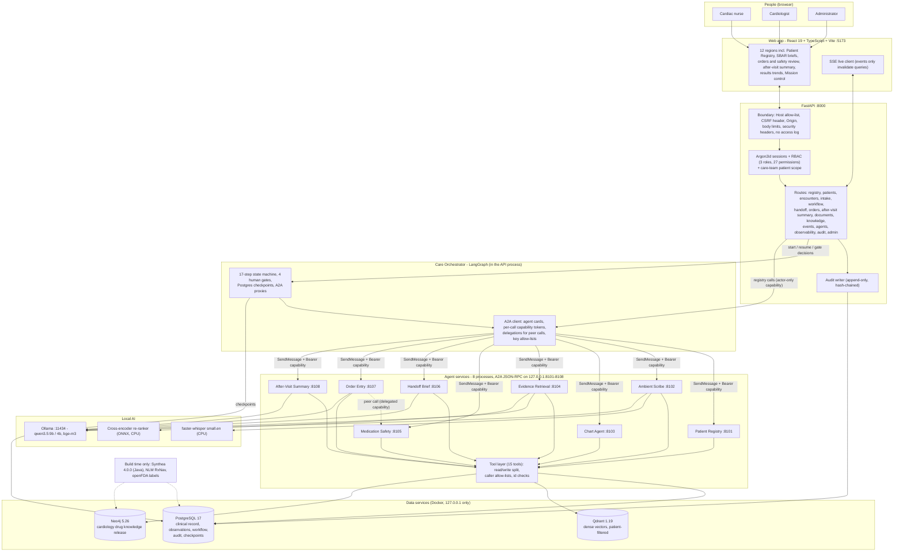
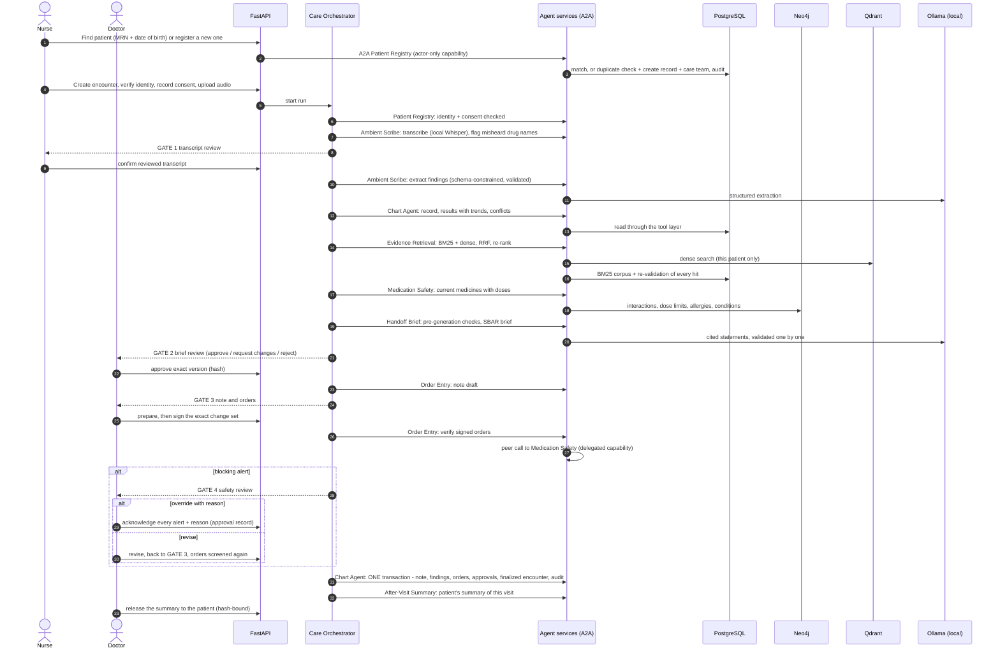
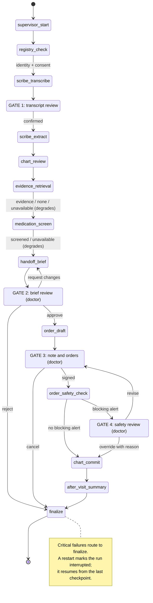
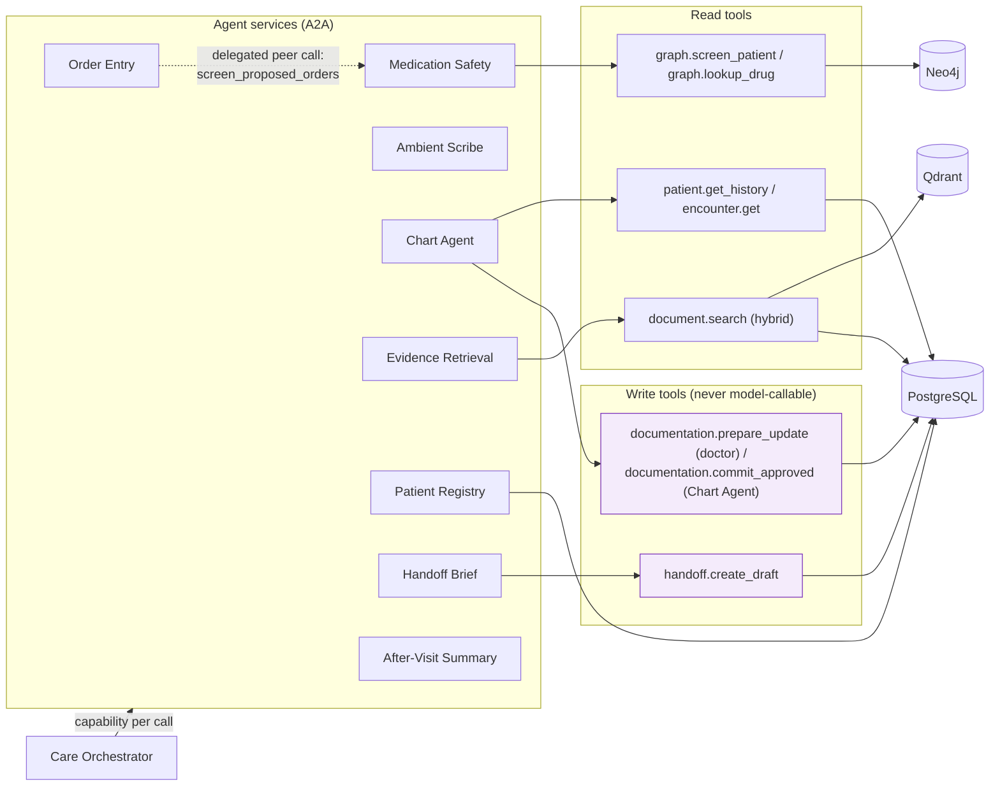
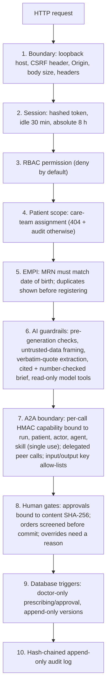
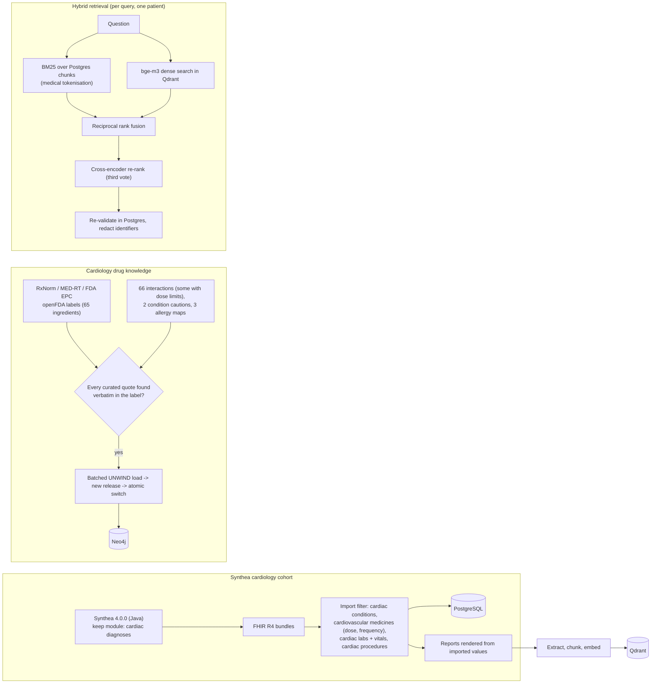
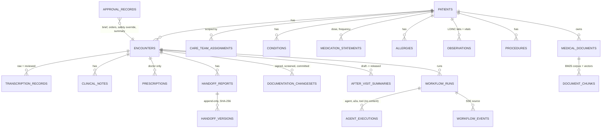
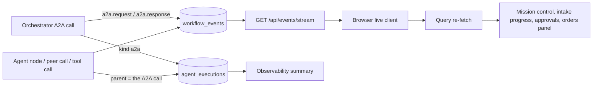
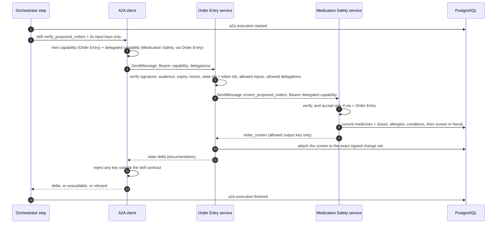

# MediBridge AI

> **New machine?** See [SETUP.md](SETUP.md) for end-to-end setup steps (written so Claude Code can follow them).

> **Synthetic-data research and demo platform. Not approved for clinical use.**
> AI supports healthcare professionals; it does not replace clinical judgment.

MediBridge AI is a local-first **cardiology** intake and doctor-handoff system built from cooperating AI agents:

1. The nurse finds the patient in the **Patient Registry** (MRN and date of birth), or registers a first-time patient.
2. The intake conversation is recorded; the **Ambient Scribe** transcribes it locally and, after a person reviews the transcript, extracts symptoms, medicines, allergies and conditions.
3. The **Chart Agent** reads the structured record (PostgreSQL), **Evidence Retrieval** finds the relevant prior reports (BM25 + vector search, fused and re-ranked), and **Medication Safety** screens current medicines and doses against a cardiology drug-knowledge graph (Neo4j, FDA/NLM sources).
4. The **Clinical Handoff Brief** writes a structured, cited cardiology brief (SBAR) after deterministic pre-generation checks. A doctor reviews and approves it.
5. The doctor writes the assessment, plan and orders. **Order Entry** has **Medication Safety** screen the proposed orders agent-to-agent. Contraindications go back to the doctor once: override with a reason, or revise.
6. The **Chart Agent** writes the record in one audited transaction, and the **After-Visit Summary** agent writes the patient's own plain-language summary of the visit, which the doctor releases.

A **Care Orchestrator** (LangGraph) runs the workflow and four human gates; the eight specialist agents are separate local services it calls over the **A2A** protocol. Nothing reaches the record without a doctor's approval, and no medical data leaves the machine.

## Quick start (Windows)

```powershell
& .\scripts\setup.ps1    # once: secrets, dependencies, local models, data services, migrations, Synthea cardiac cohort,
                         #       drug knowledge graph, document index, re-ranker, demo audio
& .\scripts\start.ps1    # data services + 8 agent services (127.0.0.1:8101-8108)
                         #       + API (127.0.0.1:8000) + web (127.0.0.1:5173)
```

Open http://127.0.0.1:5173. Demo accounts (cardiologists, cardiac nurses, administrator) are generated with random passwords in `var/demo-credentials.txt`. See [docs/runbook.md](docs/runbook.md) for the demo walkthrough, operations and troubleshooting.

## The agents

| Agent (A2A service) | Port | What it does | Skills |
|---|---|---|---|
| **Care Orchestrator** (supervisor, in the API) | - | Plans the run, enforces dependencies and the four gates, routes failures, finalizes | - |
| **Patient Registry (EMPI)** | 8101 | Master patient index: matches a returning patient by MRN + date of birth (or name + date of birth), registers a new patient with a duplicate check; confirms identity and consent before intake | `match_or_register_patient`, `verify_encounter_identity` |
| **Ambient Scribe** | 8102 | Local speech recognition (faster-whisper) with misheard-drug-name flags; extraction of findings from the reviewed transcript with verbatim grounding and negation checks | `transcribe_intake_audio`, `extract_clinical_entities` |
| **Chart Agent (EHR)** | 8103 | Reads the structured record (conditions, medicines with doses, allergies, lab results and vitals with trends, procedures, visits); writes the approved encounter back in one transaction with its audit entries | `assemble_patient_chart`, `commit_encounter_record` |
| **Evidence Retrieval** | 8104 | Hybrid search over the patient's reports: BM25 with medical tokenisation + dense vectors (Qdrant), reciprocal rank fusion, cross-encoder re-ranking; every hit re-validated in Postgres | `retrieve_clinical_evidence` |
| **Medication Safety CDS** | 8105 | Deterministic screen against the cardiology knowledge graph: interactions (label dose limits checked against the recorded dose), allergies, drug-condition cautions | `screen_current_medications`, `screen_proposed_orders` (peer-only) |
| **Clinical Handoff Brief** | 8106 | Structured SBAR cardiology brief; pre-generation checks; every statement cited and validated; privacy filter | `generate_handoff_brief` |
| **Order Entry (CPOE)** | 8107 | Drafts the note; verifies the doctor's signed orders and asks Medication Safety to screen them (agent-to-agent, delegated) | `draft_clinical_note`, `verify_proposed_orders` |
| **After-Visit Summary** | 8108 | The patient's summary of this visit: reason in their words, medicines and how to take them, next steps, when to get help | `generate_after_visit_summary` |

## Data (all synthetic, open source)

- **Patients:** a [Synthea](https://github.com/synthetichealth/synthea) 4.0.0 cardiac cohort (Apache-2.0), generated locally with a keep module that retains only patients with atrial fibrillation, heart failure, coronary disease or myocardial infarction. Only the cardiology-relevant part of each record is imported: cardiac diagnoses and risk factors, cardiovascular medicines with dose and frequency, lipids/renal/INR/troponin/NT-proBNP/HbA1c/ejection fraction, vitals, cardiac procedures, drug allergies. Reports (PDF) are rendered from those values only.
- **Drug knowledge:** 65 cardiology ingredients (anticoagulants, antiplatelets, beta-blockers, ACE inhibitors/ARBs/ARNI, calcium-channel blockers, diuretics/MRAs, statins, antiarrhythmics, nitrates, SGLT2 inhibitors and their interaction partners) from NLM RxNorm, RxClass MED-RT and FDA EPC, plus openFDA labels. 66 curated interactions and 2 drug-condition cautions, each quoting its FDA label verbatim (the build refuses any quote it cannot find), batch-loaded into Neo4j as a versioned release.

## What you can do

| Region | What you can do |
|---|---|
| Overview | Today's cardiology clinic, items awaiting review, live workflow activity, component health |
| Patients | Registry search; clinical record: timeline, results with trend charts, conditions, medications (current / historical / unknown), allergies, notes, documents, vitals |
| Intake | Patient Registry (find or register), identity verification, consent, audio recording or upload, transcript review |
| Encounters | Workspace with findings and provenance, escalation flags, conflicts, prior visits, results |
| Handoff briefs | SBAR brief with evidence citations and pre-generation checks; doctor edits as new versions; hash-bound approval; note and orders; medication-safety review (override with reason, or revise); the patient's after-visit summary (printable, released by the doctor) |
| Medical records | Document library, redacted text viewer, audited originals, hybrid search within one patient's reports, uploads |
| Medication & safety | Recorded medicines resolved to RxNorm, evidence-cited alerts with label quotes and dose checks, completeness statement, drug-relationship graph |
| Agent mission control | Live workflow graph from real execution records; per-step A2A calls, peer calls, tool calls, models, tokens; live status of the eight agent services |
| Workflow & approvals | Gates waiting for a person (transcript, brief, orders, safety review), failed or interrupted runs, recent decisions |
| Observability | Agent, A2A call, tool, model and retrieval latency, tokens, guardrail outcomes |
| Audit & governance | Hash-chained audit log with live verification (administrators) |
| Administration | Users and roles, care-team access, local model selection, configuration, diagnostics |

## Architecture

Everything runs on one machine. Every port binds to `127.0.0.1`, and no medical data is sent to a hosted service.

### 1. System architecture



### 2. End-to-end workflow



### 3. State machine (LangGraph)



### 4. Agents, peer calls and data access



### 5. Security and guardrail layers



### 6. Data pipeline: cohort, knowledge, documents and hybrid retrieval



### 7. Data model (main tables)



Each clinical fact carries its provenance: `source_kind` (patient-reported, clinician-documented, record-retrieved, unconfirmed), `source_ref` (the Synthea resource, transcript segment, note or document chunk), `source_phrase`, `certainty` and `status`. Facts a demo scenario needed but the generated record lacked are marked `scenario-augmentation:<key>`.

### 8. Live monitoring



### 9. One A2A call, with a delegated peer call



Refusals (bad or reused tokens, another patient's state, over-sharing, a peer-only skill called directly, a rogue response) are audited and block the run. Set `AGENT_TRANSPORT=inprocess` to run the same agent code inside the API for debugging.

**Limitation.** The services share one `.env`, so they share the token secret and the database credentials. A token proves it was issued by a MediBridge process on this machine, not specifically by the orchestrator; access is still bounded per call by the token's binding and by the tool layer's permission checks inside each agent.

- **Design and discovery report:** [docs/architecture/00-discovery-and-architecture.md](docs/architecture/00-discovery-and-architecture.md)
- **Guardrail enforcement and tests:** [docs/guardrails.md](docs/guardrails.md)
- **Evaluation results:** [docs/evaluation.md](docs/evaluation.md)
- **Implementation status:** [docs/IMPLEMENTATION-REPORT.md](docs/IMPLEMENTATION-REPORT.md)

## Repository layout

```
backend/medibridge_api      FastAPI app: models, routes (incl. registry), security, guardrails, providers,
                            services (hybrid retrieval: lexical.py BM25, rerank.py, vector_index.py)
agents/medibridge_agents    Care Orchestrator graph, agent nodes (registry, scribe, chart, retrieval, safety, brief,
                            orders, after-visit summary), tool layer, escalation rules;
                            a2a/: services, client, capabilities, peer calls, registry of agents and skills
mcp/medibridge_mcp          MCP server (read-only tools)
knowledge/                  Cardiology drug-knowledge fetcher, curated label-quoted set, batched Neo4j loader, screen
database/                   Alembic migrations; seed: Synthea generator + cardiac importer + scenarios
frontend/                   Dashboard (12 regions), Vitest + Playwright tests
infrastructure/             Docker Compose (Postgres, Qdrant, Neo4j; 127.0.0.1 only)
tests/                      Backend, security, workflow tests and AI evaluation harnesses
scripts/                    setup, start, stop, synthetic audio
docs/                       Architecture, guardrails, evaluation, runbook, implementation report
```

## Reuse and licences

- **Synthea** (Apache-2.0): generates the synthetic cohort locally; no Synthea source is vendored (the release jar is downloaded and checksum-verified).
- **UI and live-event patterns:** common mission-control dashboard patterns (status roles, SSE invalidation), re-implemented from scratch.
- **Password hashing and sessions:** standard Argon2id + server-side session design, written for this project (`backend/medibridge_api/security/passwords.py`).
- **Drug reference data:** RxNorm (NLM), MED-RT (VA/NLM) and FDA Established Pharmacologic Class are US Government public data; openFDA labels are CC0. The curated interaction set is demo-curated and **not clinically reviewed**.
- **Models:** Qwen3.5 (Apache-2.0), bge-m3 (MIT), Whisper small.en (MIT), jina-reranker-v1-tiny-en (Apache-2.0), Ollama (MIT).

## Author

Created and maintained by [vighnasreevara](https://github.com/vighnasreevara).
